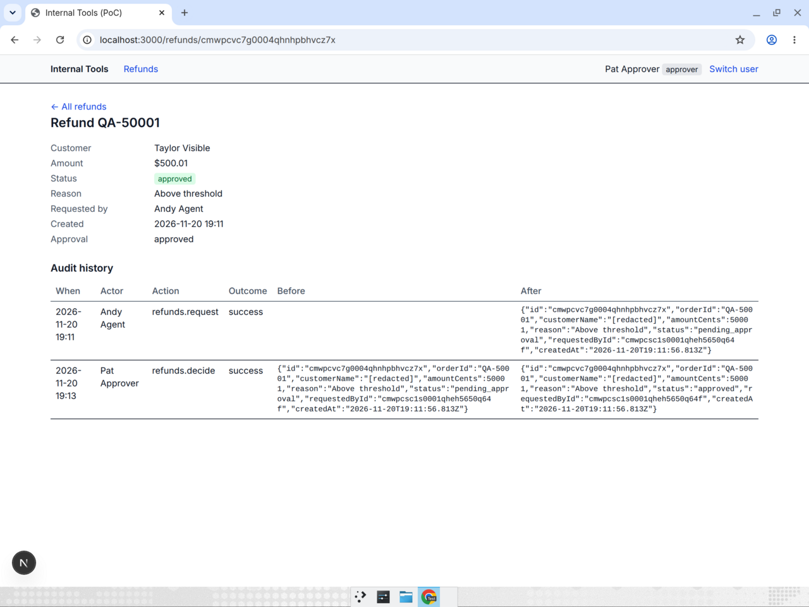
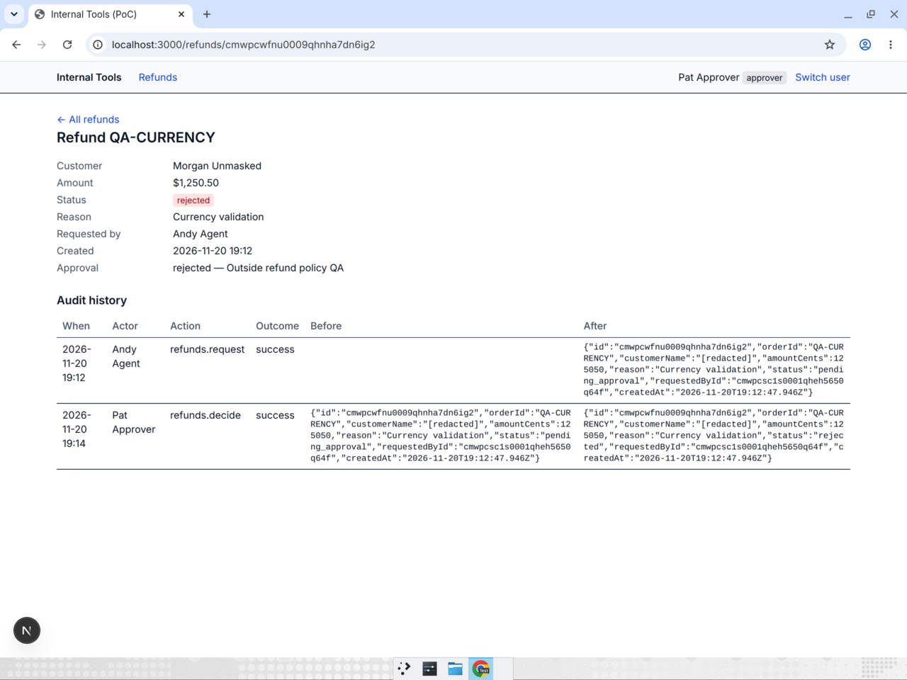
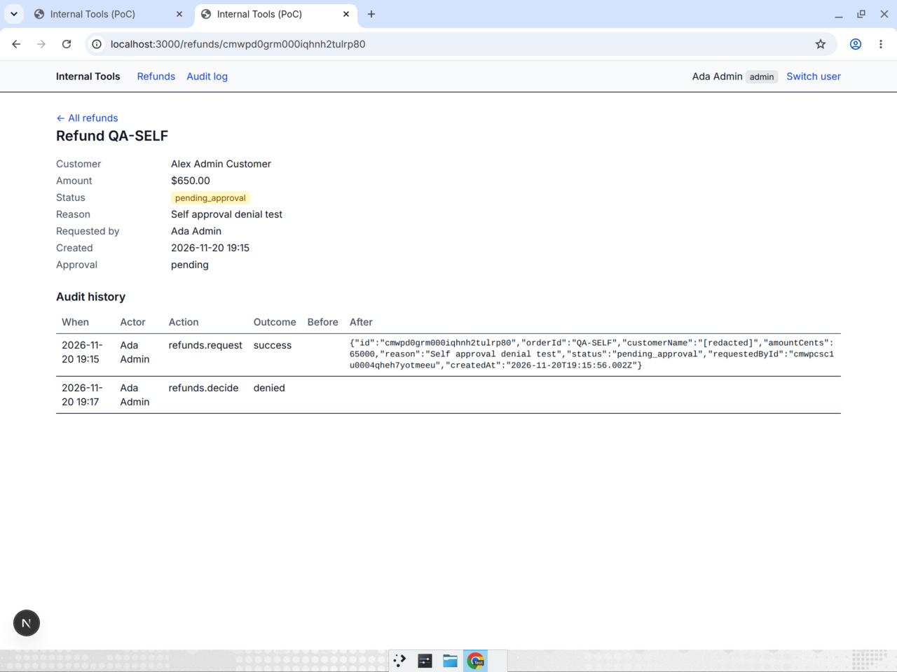
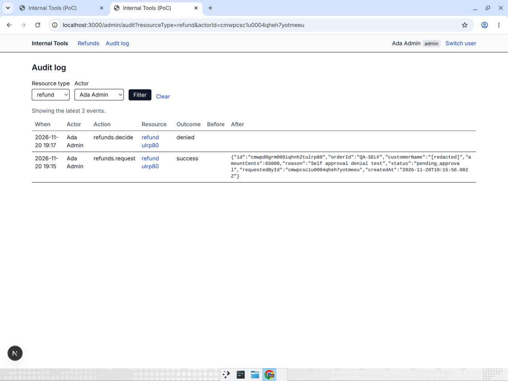
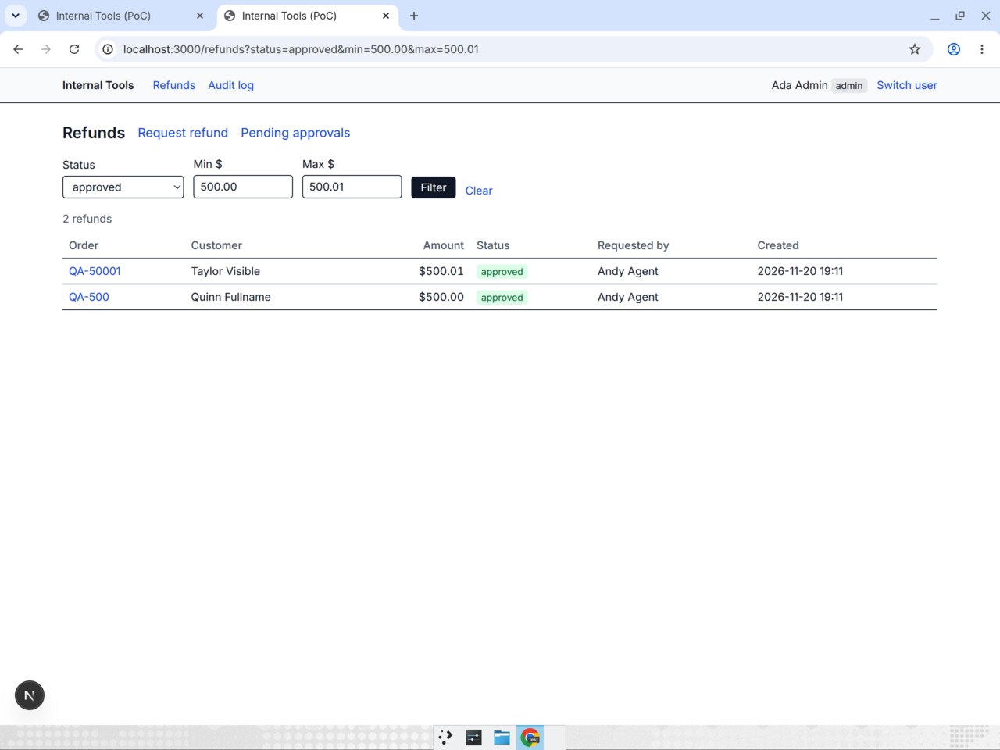
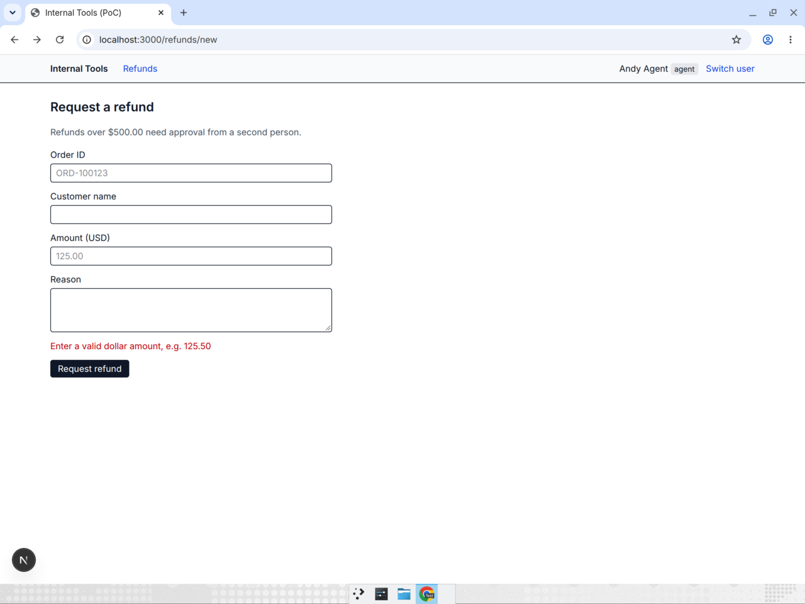

# Internal Tools Platform — proof of concept

A ~1 hour prototype to evaluate building internal tools in code instead of Microsoft Power Apps.
**This is not production software.** Auth is a demo mock that is insecure by design.

**Walkthrough video (under 5 min):** https://www.loom.com/share/d8980ad5868944289e3fcbc60dd02350

Stack: Next.js 16 (App Router), TypeScript (strict), Prisma 6 + SQLite, zod, Vitest, Tailwind.

## Run it

Requires Node 22+ (developed on Node 26; the seed uses Node's built-in TypeScript support).

```bash
npm install
cp .env.example .env          # DATABASE_URL=file:./dev.db (SQLite, not a secret)
npx prisma migrate dev        # create prisma/dev.db and apply migrations
npm run db:seed               # 5 users (one per role + a second agent), 50 fake refunds
npm run dev                   # http://localhost:3000 -> /login, pick a user
npm test                      # Vitest against a separate prisma/test.db (recreated each run)
npm run build
```

If npm 11+ blocks Prisma's install scripts, run `npm install-scripts approve prisma @prisma/client @prisma/engines` (already allow-listed in `package.json`).

## Architecture

```
platform/            shared code every app uses
  auth/              AuthProvider interface, mock cookie provider, getCurrentUser()/requireUser()
  rbac/              roles, the single permissions map, can(), requirePermission()
  action.ts          defineAction(): the only write path
  audit/             AuditEvent writer (internal), read loaders, redaction, /admin/audit page
  approvals/         generic maker-checker: requestApproval(), decideApproval()
  pii/               mask()
  ui/                Layout, nav (hardcoded list of app manifests), page guard, styles
  errors.ts, db.ts
apps/refunds/        the first app: manifest, zod schemas, actions, read loaders, UI
app/                 Next.js routes; thin re-exports of app/platform page components
prisma/              schema, migrations, seed
tests/               test setup, helpers, platform-level tests
```

- **Auth.** `getCurrentUser()` in `platform/auth` is the only way code gets the current user. It delegates
  to an `AuthProvider`. The demo provider stores a raw user id in an httpOnly cookie (`demo_session`),
  so anyone can impersonate anyone. A real OIDC provider (e.g. Entra ID) implements the same interface
  and is installed with `setAuthProvider()`; app code doesn't change. Pages call `requireUser()`, which
  redirects to `/login`.
- **Permissions.** `ROLE_PERMISSIONS` in `platform/rbac/permissions.ts` is the single map. `can(user, permission)`
  is the only check. Every read loader (`apps/refunds/queries.ts`, `platform/audit`) checks permission on the
  server before querying. Pages wrap loaders in `orForbidden()`, which turns a `ForbiddenError` into a 403.
  Hidden buttons are a convenience, not enforcement.
- **Nav.** Each app exports a manifest (`name`, `route`, `readPermission`, `config`). `platform/ui/apps.ts` is a
  hardcoded list of manifests; the nav shows only those the user can read.

## The write path: `defineAction`

```ts
export const requestRefund = defineAction({
  name: "refunds.request",
  permission: "refunds:request",
  resourceType: "refund",
  input: requestRefundInput,           // zod schema
  sensitive: ["customerName"],         // stored as "[redacted]" in audit JSON
  async run(ctx, input) {              // ctx = { user, tx, audit }
    const refund = await ctx.tx.refund.create({ ... });
    return { resourceId: refund.id, before: null, after: refund, result: refund };
  },
});
```

Calling the returned function does, in order:

1. **Authenticate**: `getCurrentUser()`; none → `UnauthenticatedError` (nothing written).
2. **Authorize**: `can(user, permission)`; no → write an AuditEvent with outcome `denied` (outside any
   transaction), throw `ForbiddenError`. If the action sets `resourceIdKey` (e.g. `refundId`), the denied row
   records that id read from the raw input; it is used only as an audit label.
3. **Validate**: zod `safeParse`; invalid → `ValidationError` (nothing written).
4. **Run** inside one `db.$transaction`: `run(ctx, input)` makes its changes with `ctx.tx`, then
   `defineAction` writes the success AuditEvent (actor, action name, resource type/id, redacted before/after
   JSON) in the same transaction, then commits.
5. If `run()` throws, the transaction rolls back: no data and no success audit row. If what it threw is a
   `ForbiddenError` (e.g. deciding your own request), a `denied` AuditEvent is written after the rollback.

`ctx.audit()` lets helpers record extra success rows in the same transaction (approvals use it).
AuditEvent is append-only: the platform exports no update or delete function for it.

### Approvals (maker-checker)

`requestApproval(ctx, { resourceType, resourceId })` and
`decideApproval(ctx, approvalId, decision, reason, { permission, resourceType, resourceId })` take the
calling action's `ctx`, so they run **inside the app's action transaction**. Deciding the approval and
updating the refund status commit or roll back together. Rules enforced in `decideApproval`:

- decider must have the app's approve permission;
- decider cannot be the requester (`ForbiddenError`, audited as denied);
- the approval must belong to the record being decided;
- a reason is required when rejecting;
- it cannot be decided twice: the decision is a conditional `updateMany({ where: { id, decidedAt: null } })`,
  and 0 rows updated means `AlreadyDecidedError`, so two concurrent deciders can't both win.

The refunds decide action also checks the refund is still `pending_approval`, and updates it with the
same kind of conditional update.

## How to add a new app (using refunds as the example)

1. **Permissions**: add e.g. `kyc:read`, `kyc:review` to `PERMISSIONS` and to the roles in
   `ROLE_PERMISSIONS` (`platform/rbac/permissions.ts`). Admin gets everything automatically.
2. **Schema**: add models to `prisma/schema.prisma` (refunds: `Refund`, money as integer cents), then
   `npx prisma migrate dev --name add_kyc`. Add fake seed data in `prisma/seed.ts`.
3. **Manifest**: `apps/kyc/manifest.ts` like `apps/refunds/manifest.ts` (name, route, readPermission, config).
   Add it to `APPS` in `platform/ui/apps.ts`.
4. **Schemas**: zod inputs in `apps/kyc/schemas.ts` (see `apps/refunds/schemas.ts`).
5. **Actions**: every write is a `defineAction` in `apps/kyc/actions.ts`. Mark PII fields in `sensitive`.
   Need sign-off? Call `requestApproval`/`decideApproval` from inside `run`, as `apps/refunds/actions.ts` does.
6. **Read loaders**: `apps/kyc/queries.ts`; each starts with `requireUser()` + `requirePermission(...)`.
   Show PII with `mask()` from `platform/pii`; never send unmasked values to the browser.
7. **UI**: server page components in `apps/kyc/ui/` that call loaders via `orForbidden()`. Client forms call
   thin `"use server"` wrappers (`apps/refunds/server-actions.ts`) that call the actions.
8. **Routes**: one-line re-exports under `app/(platform)/kyc/...` (see `app/(platform)/refunds/page.tsx`).
9. **Tests**: for every action, a role without the permission is rejected and the denial is audited
   (see `apps/refunds/refunds.test.ts`); loaders reject roles without read permission (`tests/reads.test.ts`).

## Test evidence

Screenshots from a manual browser test of the seeded app (commit `4c36705`). All data is fake.


A $500.01 refund went to `pending_approval` and was approved by a second person; audit JSON shows `customerName` as `[redacted]`.


Rejection stores its reason, and the refund status and audit history update to match.


An admin's attempt to approve their own refund is denied by the server, audited as `denied`, and the refund stays pending.


`/admin/audit` filters by resource type and actor.


The refund list's amount range is inclusive: $500.00–$500.01 returns both boundary refunds. The $500.00 one was approved immediately, and the $500.01 one after approval.


A malformed amount (`125,50`) is rejected with an error and no refund is created.

### KYC review queue

Screenshots from a browser test of the seeded KYC app as each role, in [`docs/test-evidence/kyc/`](docs/test-evidence/kyc/). All data is fake. The HTML, RSC and server-action responses for the queue and case pages contained no unmasked seeded SSN or DOB, apart from the single reveal response.

| Screenshot | Shows |
|---|---|
| `viewer-home-kyc-hidden`, `viewer-queue-forbidden`, `viewer-case-forbidden` | Viewers don't see the app; `/kyc` and `/kyc/[id]` return 403 |
| `agent-queue-status-risk-filters`, `agent-assigned-to-me-filter` | Queue with masked SSNs; status, risk and assigned-to-me filters |
| `agent-assigned-note-added` | Agent assigns a pending case to themselves and adds a note |
| `agent-empty-escalation-blocked`, `agent-escalated-no-decide-or-reveal` | Escalation needs a reason; agents get no approve, reject or reveal controls |
| `approver-empty-approve-blocked`, `approver-empty-reject-blocked`, `approver-rejected-with-reason` | Approve and reject need a reason |
| `approver-approved-final-locked`, `approver-seeded-*-final-locked`, `agent-*-final-locked` | Approved and rejected cases have no action or note forms |
| `admin-self-decision-denied`, `admin-escalator-decision-denied` | An admin can't decide a case they were assigned to or escalated |
| `approver-ssn-revealed`, `reveal-audit-redacted-after-reload` | Approver reveals one SSN; the audit row records `{"revealedField":"ssn"}` and no SSN |
| `reveal-audit-immediate` | After the fix, the reveal audit row appears right away and the SSN stays visible |

### Production access requests

Screenshots from a browser test of the seeded access app as each role, in [`docs/test-evidence/access/`](docs/test-evidence/access/). All data is fake.

| Screenshot | Shows |
|---|---|
| `viewer-list-active-first`, `viewer-active-no-actions`, `viewer-new-direct-url-403` | Viewers see the list (active grants first) but no request or action controls; `/access/new` returns 403 |
| `viewer-stale-revoke-server-rejected`, `viewer-revoke-denied-audit-active-unchanged` | A forged viewer revoke is rejected on the server and audited; the grant stays active |
| `agent-request-pending-audit` | Agent requests access; the request is pending with an audit row |
| `approver-empty-approve-blocked`, `approver-empty-deny-blocked` | Approve and deny need a reason |
| `approver-approved-active-audit`, `approver-denied-with-reason-final-audit` | Approval grants access with an expiry; denial keeps its reason and is final |
| `agent-other-active-no-revoke`, `agent-other-revoke-rejected-stale-form`, `agent-other-revoke-denied-audit-after-reload` | An agent can't revoke another user's grant (before the fix, the denied row appeared only after reload) |
| `agent-empty-revoke-blocked`, `agent-own-revoked-final-with-reason`, `agent-own-revoke-full-audit-history` | An agent revokes their own grant with a reason; full request, approval and revoke audit trail |
| `agent-other-revoke-denied-audit-immediate` | After the fix, the denied revoke row appears right away |
| `admin-own-approve-and-deny-blocked-stale-form`, `admin-own-decision-denied-audit-still-pending` | An admin can't approve or deny their own request |
| `approver-expired-final-no-actions`, `approver-revoked-final-no-actions` | Expired and revoked grants have no action forms |
| `filter-*`, `agent-mine-filter`, `agent-active-system-mine-combined-filter` | Status filters (including expired), system filters, Mine, and combined |

## Known limitations

- **Mock auth**: no passwords, unsigned cookie with a raw user id, no CSRF beyond Next.js server-action defaults.
- **SQLite**: single file, writes serialize; fine for a demo, not for production.
- **No deployment, no notifications**, no pagination (audit page shows the latest 200 events), no design polish.
- **Seed data bypasses `defineAction`** and has no audit history.
- **The write path is a convention**, checked by tests and code review, not a hard guarantee: any file could
  import `db` and write directly. Production would add a CI/lint rule banning Prisma writes outside
  `platform/action.ts` and use restricted database permissions (e.g. an app role with no UPDATE/DELETE on the
  audit table).
